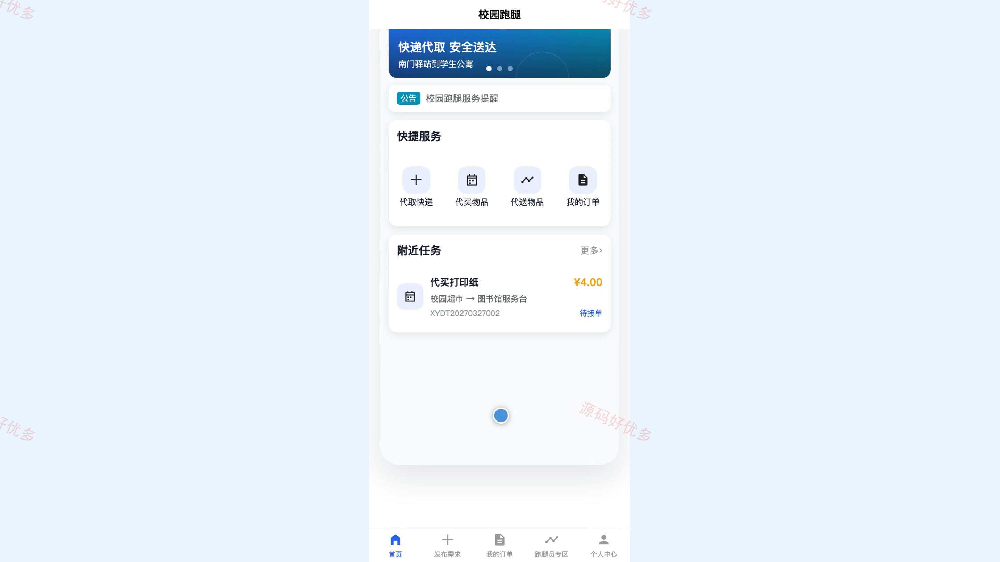
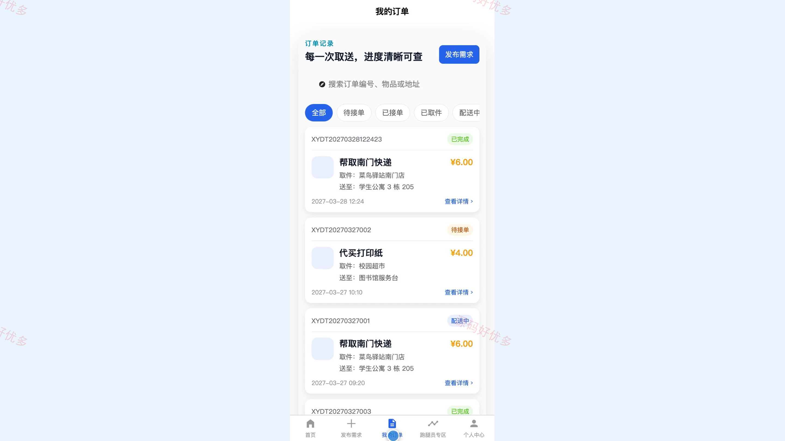
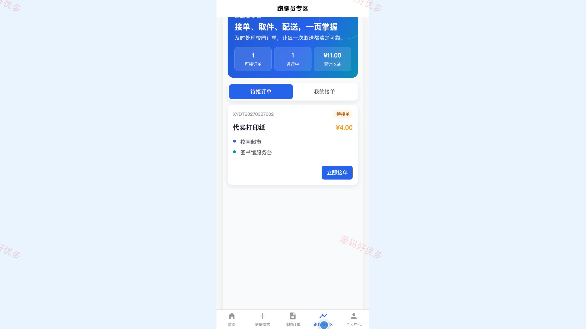
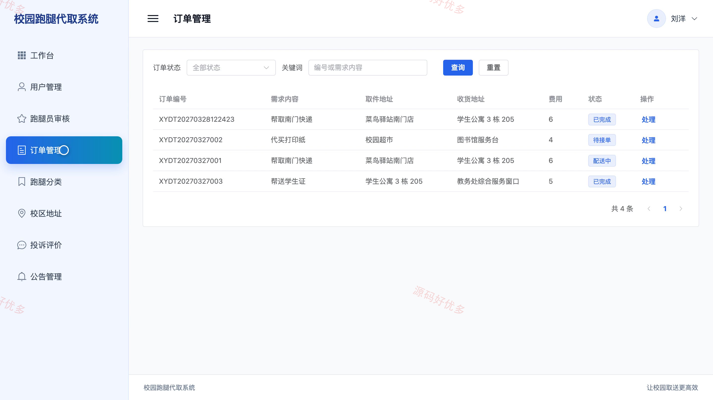
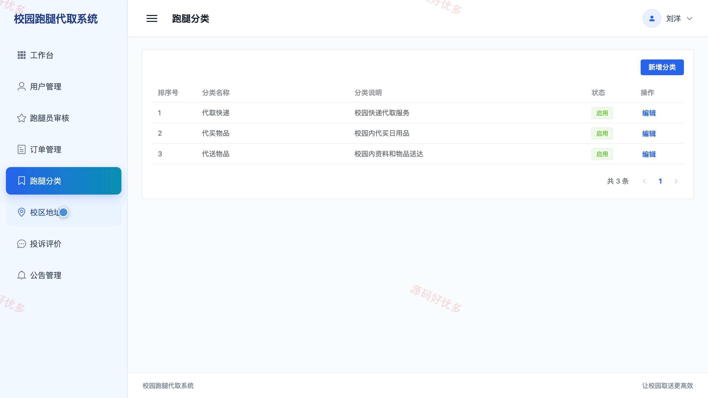

# bs004B
bs004B校园跑腿代取服务小程序源码 Java SpringBoot3 Vue3 文档 PPT
## 源码问题查看主页咨询

### 一、关键词
校园跑腿、代取快递、同城配送、跑腿服务、校园互助

### 二、作品包含
源码+数据库+万字设计文档+PPT+全套环境和工具资源+本地部署教程

### 三、项目技术
前端技术： Html、Css、Js、Vue3.4、Element-Plus、uniapp
后端技术：Java、SpringBoot3.2.0、MyBatis-Plus

### 四、运行环境要求
开发工具：IDEA/eclipse + VSCODE + HBuilder X + 微信开发者工具

数据库：MySQL5.7+（共10张表）

数据库管理工具：Navicat10以上版本

环境配置软件： JDK17 + Maven3.6

前端Nodejs：16+

浏览器：谷歌浏览器

### 五、项目介绍
项目编号：bs004B

本项目面向校园代取、代买和代送场景，学生用户可在微信小程序发布跑腿需求、跟踪订单并确认收货评价，跑腿员可接单、核验取件码和更新配送状态，管理员在 PC 管理端完成人员审核、订单、分类、校区地址、投诉评价和公告维护。系统通过取件码核验与分阶段状态流转，保证取送过程清晰可追踪。

角色：学生用户、跑腿员、管理员

学生用户功能：注册登录、发布跑腿需求、查看可接订单、订单状态跟踪、确认收货与评价、历史订单管理、个人资料管理。

跑腿员功能：跑腿员申请与登录、查看待接订单、接取跑腿订单、取件码核验、配送状态更新、接单记录查询、个人收益统计。

管理员功能：用户信息管理、跑腿员入驻审核、跑腿订单管理、跑腿分类管理、校区地址管理、投诉与评价管理、公告信息管理、运营数据统计。

### 六、运行截图

